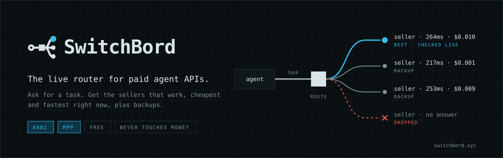
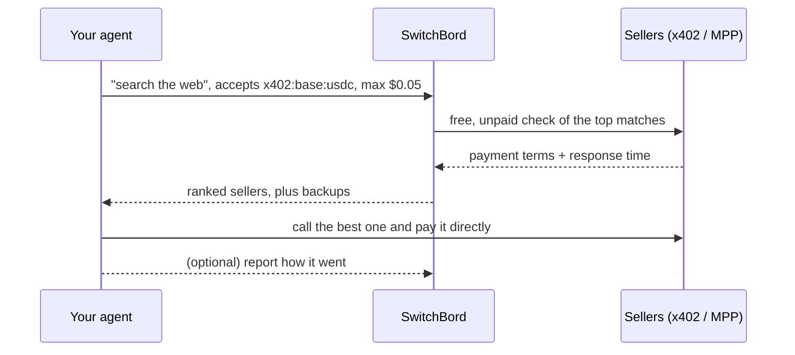

<p align="center">
  <a href="https://switchbord.xyz">
    <picture>
      <source media="(prefers-color-scheme: dark)" srcset="assets/banner-dark.svg">
      <source media="(prefers-color-scheme: light)" srcset="assets/banner-light.svg">
      
    </picture>
  </a>
</p>

<p align="center">
  <a href="https://switchbord.vercel.app/healthz"></a>
  <a href="https://registry.modelcontextprotocol.io/v0/servers?search=switchbord"></a>
  
  <a href="LICENSE"></a>
</p>

<p align="center">
  <a href="https://switchbord.xyz"><b>Website</b></a> ·
  <a href="#quick-start"><b>Quick start</b></a> ·
  <a href="API.md"><b>API</b></a> ·
  <a href="MCP.md"><b>MCP setup</b></a> ·
  <a href="#run-it-yourself"><b>Self-host</b></a>
</p>

---

Agents can now pay for APIs on their own, over **x402** and **MPP**. There are tens of thousands of paid endpoints, and many of them are down, slow or overpriced at any given moment. **SwitchBord tells your agent which ones to call.** It asks for a task in plain words, like "search the web" or "ETH price", and gets back the sellers that are working, cheapest and fastest right now, checked live just before the answer, plus backups.

|  |  |
|---|---|
| **Free and open** | No signup, no keys, no auth. MIT-licensed code you can read, run and fork. |
| **Never touches your money** | Your agent pays the seller directly with its own wallet. SwitchBord only says who to call. |
| **Live, not a directory** | The top candidates get a free, unpaid check right before the answer, so dead sellers drop out. |
| **One inventory, every protocol** | Every endpoint on Coinbase Bazaar (x402) and mpp.dev (MPP), rebuilt daily and grouped into markets of interchangeable sellers. |

## Quick start

**Claude Code**

```bash
claude mcp add --transport http switchbord https://switchbord.vercel.app/mcp
```

**Cursor, Windsurf, Cline** and any client that reads an `mcpServers` block:

```json
{ "mcpServers": { "switchbord": { "type": "http", "url": "https://switchbord.vercel.app/mcp" } } }
```

<details>
<summary><b>Plugins, Gemini CLI and other clients</b></summary>
<br>

- **Claude Code plugin:** `/plugin marketplace add 6ixtyy/switchbord`, then `/plugin install switchbord@switchbord`
- **Gemini CLI:** `gemini extensions install https://github.com/6ixtyy/switchbord`
- **Claude Desktop, VS Code and others:** see [MCP.md](MCP.md)

</details>

**Or just call the HTTP API:**

```bash
curl "https://switchbord.vercel.app/route?task=search%20the%20web&accepts=x402:base:usdc&max_price=0.05"
```

## What you get back

A real answer for "search the web", trimmed to two candidates:

```jsonc
{
  "mode": "market",
  "market": "web-search",
  "sellersMatched": 99,
  "candidates": [
    {
      "rank": 1,
      "service": "StableEnrich",
      "method": "POST",
      "url": "https://stableenrich.dev/api/exa/search",
      "priceUsd": 0.01,
      "pay": ["x402:base:usdc"],
      "charges": "after_success",          // x402: only charged when the seller answers OK
      "input": { "body": { "query": "…", "numResults": 10 } },
      "up": true, "ms": 264                // checked live just now
    },
    {
      "rank": 2,
      "url": "https://win.oneshotagent.com/v1/tools/search",
      "priceUsd": 0.001,
      "up": true, "ms": 217
      // …
    }
  ]
}
```

Every field is documented in [API.md](API.md). Runnable snippets are in [examples/](examples/).

## How it works



1. **Inventory.** Every day SwitchBord pulls every listed endpoint from Coinbase Bazaar and mpp.dev, merges them and groups interchangeable sellers into markets.
2. **Match.** Your task is matched to a market. If none fits, you still get the closest single endpoints.
3. **Check live.** The top candidates get an unpaid request that reads their payment terms, so sellers that are down or misconfigured drop out.
4. **Rank.** Candidates are ordered by health, speed, price and real-world results. The full logic is in [`src/router.ts`](src/router.ts) and [`src/health.ts`](src/health.ts).

## Reference

| MCP tool | Use it to |
|---|---|
| `find_paid_endpoint` | Get the best sellers for a task, with backups. Pass `accepts` (e.g. `["x402:base:usdc"]`) so you only get sellers you can pay. |
| `list_markets` | See the markets and how many sellers each has. |
| `report_result` | Optional: say how a call went, which improves rankings for everyone. |

| HTTP endpoint | What it returns |
|---|---|
| `GET /route?task=…` | Ranked sellers for a task, checked live |
| `GET /markets` | Markets and seller counts |
| `GET /endpoints/:id` | One endpoint from the inventory |
| `POST /report` | Optional: how a call went |
| `GET /healthz` | Inventory size and when it was last rebuilt |
| `POST /mcp` | The MCP server (streamable HTTP, stateless) |

## Paying sellers

SwitchBord does not pay for you, hold funds, or guarantee sellers. To call a paid seller, your agent needs its own wallet and an x402 or MPP client, for example Coinbase's [`@x402/fetch`](https://www.npmjs.com/package/@x402/fetch). Each candidate says how it charges:

- `after_success` (x402): charged only when the seller answers OK, so trying a backup after a failure is safe.
- `before_handler` (MPP): charged up front.

## Run it yourself

The hosted service at `switchbord.vercel.app` runs this code. You can run your own copy with Node 22:

```bash
git clone https://github.com/6ixtyy/switchbord && cd switchbord
npm ci
npm run inventory   # pull Bazaar + mpp.dev, merge and classify → data/inventory.json
npm start           # API and MCP on http://localhost:8402
```

Everything works with no configuration. These environment variables are optional:

| Variable | What it does | Without it |
|---|---|---|
| `PORT` | Port for the local server | `8402` |
| `SB_REBUILD_MS` | How often the local server rebuilds the inventory | every 6 hours |
| `DATABASE_URL` or `POSTGRES_URL` | Saves every live check to Postgres | `data/checks.jsonl` |
| `BLOB_READ_WRITE_TOKEN` | Keeps state in Vercel Blob between serverless runs | local files |
| `CRON_SECRET` | Lets your scheduler run the rebuild and sampling routes at any time | open to anyone, rate-limited |

To deploy on Vercel, import the repo: `vercel.json` builds the inventory and the function, and runs the daily rebuild.

<details>
<summary><b>Code map</b></summary>
<br>

| Path | What |
|---|---|
| [`src/sources/`](src/sources/) | Pull listings from Coinbase Bazaar (x402) and mpp.dev (MPP) |
| [`src/inventory.ts`](src/inventory.ts), [`markets.ts`](src/markets.ts), [`labels.ts`](src/labels.ts) | Merge into one inventory, group into markets, label payment options |
| [`src/health.ts`](src/health.ts) | Free live checks: an unpaid request that reads the seller's 402 |
| [`src/router.ts`](src/router.ts) | Matching, ranking and backups |
| [`src/history.ts`](src/history.ts) | Check history (Postgres or a local file) |
| [`src/app.ts`](src/app.ts), [`mcp-tools.ts`](src/mcp-tools.ts) | HTTP API and the remote MCP server |
| [`src/server.ts`](src/server.ts), [`vercel.ts`](src/vercel.ts) | Local server and Vercel entry |
| [`site/`](site/) | [switchbord.xyz](https://switchbord.xyz): one static page, no build step |
| [`scripts/`](scripts/) | Vercel build and the API contract check |
| [`examples/`](examples/) | curl, Node and MCP snippets |

</details>

## Contributing

Issues and pull requests are welcome. Bad rankings, dead sellers, new protocols and docs fixes are all useful. Read [CONTRIBUTING.md](CONTRIBUTING.md) first; for security issues see [SECURITY.md](SECURITY.md). What changed: [CHANGELOG.md](CHANGELOG.md). For language models: [llms.txt](llms.txt). Privacy: [PRIVACY.md](PRIVACY.md).

## License

[MIT](LICENSE)
